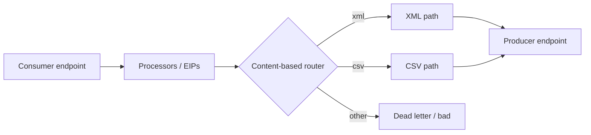

# Spring Integration Learning

Hands-on path for Apache Camel Enterprise Integration Patterns (EIPs) with Spring Boot 3, Java 21, and Camel 4.

[](https://github.com/blaze-b/spring-integration-learning/actions/workflows/ci.yml)

## Chapter 0: Camel and EIP basics

Apache Camel is an integration framework. You describe **routes**: how messages move from a consumer endpoint through processors, EIPs, and out to producer endpoints.

Core ideas:

- **Exchange** — the message container (headers, body, properties).
- **Endpoint URI** — `scheme:path?options` (for example `file:data/inbox`, `sql:select ...`, `kafka:topic`).
- **RouteBuilder** — Java DSL where you declare `from(...).to(...)` and EIP steps.
- **EIP** — reusable messaging patterns (content-based router, filter, multicast, wire tap, dead letter channel, and more).



### Chapters

| Chapter | Module | Focus |
|--------:|--------|--------|
| 0 | *(this README)* | Camel and EIP basics |
| 1 | [camel-in-action](camel-in-action/) | File routes, CBR, filter, multicast, wire tap, recipient list |
| 2 | [camel-sql](camel-sql/) | Camel SQL component with embedded H2 |
| 3 | [camel-bindy-csv](camel-bindy-csv/) | Bindy CSV marshal / unmarshal |
| 4 | [camel-kafka](camel-kafka/) | Camel Kafka producer and consumer |
| 5 | [activemq-jms](activemq-jms/) | Plain Spring JMS (contrast with Camel) |
| 6 | [course-enrolment-pipeline](course-enrolment-pipeline/) | Capstone: REST → DB → Camel → Kafka |

### Prerequisites

- JDK 21+
- Maven 3.9+
- Docker (for the Chapter 6 docker-compose stack and Testcontainers)

### Build everything

```bash
mvn verify
```

### Repository

https://github.com/blaze-b/spring-integration-learning

Next: [Chapter 1: Camel in action](camel-in-action/)
