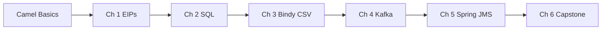
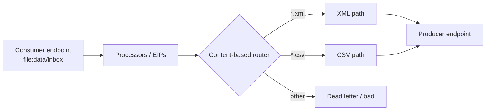

# Spring Integration Learning

Hands-on chapters for Apache Camel Enterprise Integration Patterns with Spring Boot — each module is a small, runnable app you can build, run, and debug. Aimed at developers who already know Java and Spring Boot basics and want a clear path from file/SQL routes through Kafka and JMS into a full enrolment-style pipeline.

[](https://github.com/blaze-b/spring-integration-learning/actions/workflows/ci.yml)

## Chapters

| Chapter | Module | What You Learn | Key Tech |
|--------:|--------|----------------|----------|
| 1 | [`camel-in-action`](camel-in-action/) | File ingest, content-based router, filter, multicast, wire tap, recipient list | Camel Java DSL, SEDA, file, XPath |
| 2 | [`camel-sql`](camel-sql/) | Timer-driven SQL polling and row-level routing | Camel SQL, Spring JDBC/JPA, H2 |
| 3 | [`camel-bindy-csv`](camel-bindy-csv/) | Marshal / unmarshal CSV with Bindy models | Camel Bindy, file |
| 4 | [`camel-kafka`](camel-kafka/) | Produce and consume Kafka messages from Camel | Camel Kafka |
| 5 | [`activemq-jms`](activemq-jms/) | Contrast chapter: plain Spring JMS without Camel | Spring JMS, ActiveMQ |
| 6 | [`course-enrolment-pipeline`](course-enrolment-pipeline/) | Capstone: REST → Postgres → Camel → Kafka → audit | Flyway, Postgres, Kafka, Testcontainers |

## Learning Path



Start with **Camel Basics** below, then work the modules in order. Chapter 5 is intentionally **not** Camel — it shows the same messaging idea with plain Spring JMS so you can compare styles before the capstone.

## Prerequisites

| Tool | Version | Check |
|------|---------|-------|
| JDK | **21+** | `java -version` |
| Maven | **3.9+** | `mvn -version` |
| Docker | **20+** (Compose v2) | `docker compose version` |

Docker is required for Chapter 6 (`docker compose` + Testcontainers). Chapters 1–3 run without external brokers. Chapter 4 needs Kafka (reuse Chapter 6 compose). Chapter 5 needs an ActiveMQ Classic broker you start yourself.

Stack pinned in the root POM: **Java 21**, **Spring Boot 3.3.5**, **Apache Camel 4.8.1**.

## Repo Layout

```text
spring-integration-learning/
├── pom.xml                         # aggregator / parent
├── README.md                       # overview + Camel Basics
├── .github/workflows/ci.yml        # mvn verify + gitleaks
├── .gitleaks.toml
├── camel-in-action/                # Chapter 1
├── camel-sql/                      # Chapter 2
├── camel-bindy-csv/                # Chapter 3
├── camel-kafka/                    # Chapter 4
├── activemq-jms/                   # Chapter 5 (producer + receiver)
│   ├── activemq-producer/
│   └── activemq-receiver/
└── course-enrolment-pipeline/      # Chapter 6 capstone
    └── docker-compose.yml          # Postgres + Kafka KRaft (+ optional Kafdrop)
```

## Quick Start

### Build Everything

```bash
mvn verify
```

### Run One Chapter

```bash
# Chapter 1 — content-based router (default demo)
cd camel-in-action && mvn spring-boot:run

# Chapter 2 — SQL poll against in-memory H2
cd camel-sql && mvn spring-boot:run

# Chapter 3 — write CSV under data/out
cd camel-bindy-csv && mvn spring-boot:run
```

File-based demos must see relative `data/…` paths — run from the module directory.

### Run The Capstone With Docker Compose

```bash
cd course-enrolment-pipeline
docker compose up -d postgres kafka
# optional UI on http://localhost:9000
docker compose --profile ui up -d kafdrop

export ENROLMENT_DB_URL=jdbc:postgresql://localhost:5432/enrolment
export ENROLMENT_DB_USER=enrolment
export ENROLMENT_DB_PASSWORD=enrolment
export KAFKA_BROKERS=localhost:9092

mvn spring-boot:run
```

```bash
curl -s -X POST http://localhost:8086/api/enrolments \
  -H 'Content-Type: application/json' \
  -d '{"studentId":"STU-2001","courseCode":"CRS-CAM-101","enrolledDate":"2026-02-01"}'
```

Full walkthrough: [Chapter 6: Course Enrolment Pipeline](course-enrolment-pipeline/).

---

## Camel Basics

Apache Camel is an **integration framework**. You describe **routes**: how messages move from a consumer endpoint through processors and Enterprise Integration Patterns (EIPs), then out to producer endpoints. Spring Boot auto-configures a `CamelContext` and picks up `RouteBuilder` beans.

### Glossary

| Term | Meaning |
|------|---------|
| **CamelContext** | The runtime that owns components, routes, and the type converter registry |
| **Route** | A processing graph: `from(endpoint)…to(endpoint)` declared in a `RouteBuilder` |
| **Endpoint** | A channel address as a URI: `scheme:path?options` (e.g. `file:data/inbox`, `kafka:topic`) |
| **Component** | The plugin behind a URI scheme (`file`, `sql`, `kafka`, `seda`, …) |
| **Exchange** | The message container for one routing step (headers, body, properties, exception) |
| **Message** | The payload + headers on an exchange (`getIn()` / `getMessage()`) |
| **Processor** | Code that reads/writes an exchange (`process(e -> …)` or a bean method) |
| **EIP** | A named messaging pattern (content-based router, filter, multicast, wire tap, dead letter channel, …) |
| **SEDA** | In-VM staged event-driven queue — useful in demos instead of a real broker |

### A Minimal Route

```java
from("file:data/inbox?noop=true")
    .routeId("file-copy")
    .log("Copying ${header.CamelFileName}")
    .to("file:data/outbox");
```



You will see this shape again in Chapter 1 (files + SEDA) and Chapter 6 (SQL + Kafka + DLQ).

### Next Steps

1. Skim the glossary and diagram above.
2. Run [Chapter 1: Camel In Action](camel-in-action/) and watch the content-based router logs.
3. Continue through SQL, Bindy, Kafka, the JMS contrast chapter, and the enrolment capstone.

---

## Conventions

- **Book title**: root README is `# Spring Integration Learning` (target repo name as words).
- **Chapter titles**: `# Chapter N: Title Case Title` in each module README (Chapters 1–6).
- **Packages**: `com.blazeb.camel.<module>…`
- **Config**: properties + env placeholders only — no real passwords or personal paths in git.
- **Tests**: every module has at least a smoke / unit test; the capstone adds a Testcontainers IT (skipped when Docker is unavailable).
- **Links**: relative Previous / Next between chapters.

## Troubleshooting

| Symptom | Things To Check |
|---------|-----------------|
| `mvn` / compiler errors on Java 8 APIs | Confirm JDK 21 (`JAVA_HOME`, `java -version`) |
| File routes do nothing | Working directory must see `data/inbox*` (run from the module folder) |
| Kafka clients cannot connect | Start Chapter 6 compose; use `KAFKA_BROKERS=localhost:9092` |
| Capstone Flyway fails | Postgres must be up; URL/user/password match compose defaults |
| gitleaks fails in CI | Do not commit secrets, jars of third-party drivers, or personal paths |

## Further Reading

- [Apache Camel documentation](https://camel.apache.org/manual/index.html)
- [Camel Spring Boot](https://camel.apache.org/camel-spring-boot/4.8.x/index.html)
- [Enterprise Integration Patterns](https://www.enterpriseintegrationpatterns.com/)

## License

Public learning material for https://github.com/blaze-b/spring-integration-learning

Next: [Chapter 1: Camel In Action](camel-in-action/)
