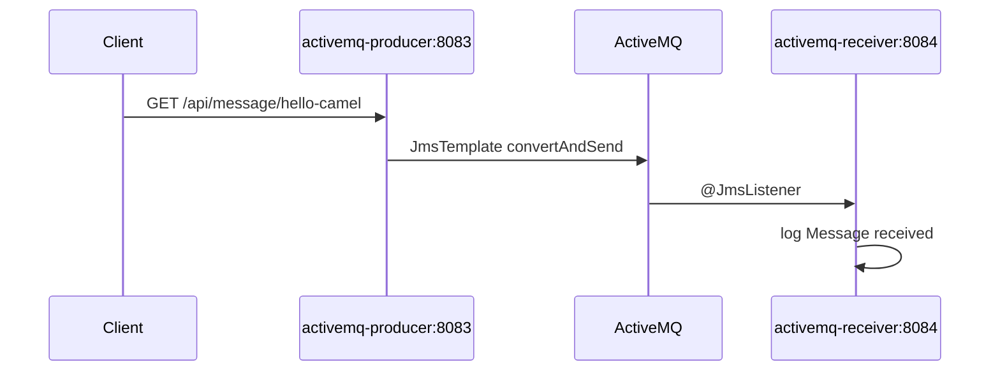

# Chapter 5: ActiveMQ JMS

Contrast chapter: the same queue messaging idea as earlier Camel demos, but with **plain Spring JMS** (`JmsTemplate` + `@JmsListener`) instead of Camel routes.

## Goal

See how far Spring Boot’s ActiveMQ starter goes for simple send/receive — and why Camel EIPs still matter once routing grows beyond a single queue.

## What You Will Learn

- Configuring `spring.activemq.*` with env placeholders (no hardcoded credentials in git)
- REST-triggered producer with `JmsTemplate`
- Annotation-driven consumer with `@JmsListener`
- Running producer and receiver as separate Spring Boot apps

## Prerequisites / Previous

- [Chapter 4: Camel Kafka](../camel-kafka/)
- An **ActiveMQ Classic** broker listening on OpenWire (default `tcp://localhost:61616`)

## Concepts



| Module | Port | Role |
|--------|-----:|------|
| `activemq-producer` | 8083 | HTTP → queue |
| `activemq-receiver` | 8084 | queue → log |

## Code Walkthrough

| Class / Path | Role |
|--------------|------|
| [`ActivemqProducerApplication`](activemq-producer/src/main/java/com/blazeb/camel/activemq/producer/ActivemqProducerApplication.java) | Producer entry point |
| [`JmsConfig`](activemq-producer/src/main/java/com/blazeb/camel/activemq/producer/config/JmsConfig.java) | `ActiveMQQueue` bean from `activemq.queue.name` |
| [`MessageController`](activemq-producer/src/main/java/com/blazeb/camel/activemq/producer/controller/MessageController.java) | `GET /api/message/{message}`, `GET /api/messages` |
| [`ActivemqReceiverApplication`](activemq-receiver/src/main/java/com/blazeb/camel/activemq/receiver/ActivemqReceiverApplication.java) | Receiver entry point |
| [`MessageConsumer`](activemq-receiver/src/main/java/com/blazeb/camel/activemq/receiver/consumer/MessageConsumer.java) | `@JmsListener` logger |
| [`MessageControllerTest`](activemq-producer/src/test/java/com/blazeb/camel/activemq/producer/MessageControllerTest.java) | MockMvc + mocked `JmsTemplate` |
| [`MessageConsumerTest`](activemq-receiver/src/test/java/com/blazeb/camel/activemq/receiver/MessageConsumerTest.java) | Smoke: listener accepts a string |

```java
@GetMapping("/message/{message}")
public ResponseEntity<String> publish(@PathVariable("message") String message) {
    jmsTemplate.convertAndSend(queue, message);
    return ResponseEntity.ok(message);
}
```

```java
@JmsListener(destination = "${activemq.queue.name}")
public void onMessage(String message) {
    log.info("Message received: {}", message);
}
```

## How To Run

### 1. Export Broker Settings

Do **not** commit real passwords. Supply them at runtime:

```bash
export ACTIVEMQ_BROKER_URL=tcp://localhost:61616
export ACTIVEMQ_USER=your-user
export ACTIVEMQ_PASSWORD=your-password
export ACTIVEMQ_QUEUE_NAME=learning-queue
```

| Property / Env | Default in repo |
|----------------|-----------------|
| `spring.activemq.broker-url` / `ACTIVEMQ_BROKER_URL` | `tcp://localhost:61616` |
| `spring.activemq.user` / `ACTIVEMQ_USER` | *(empty — set for your broker)* |
| `spring.activemq.password` / `ACTIVEMQ_PASSWORD` | *(empty — set for your broker)* |
| `activemq.queue.name` / `ACTIVEMQ_QUEUE_NAME` | `learning-queue` |

### 2. Start Receiver, Then Producer

```bash
cd activemq-jms/activemq-receiver && mvn spring-boot:run
# other terminal
cd activemq-jms/activemq-producer && mvn spring-boot:run
```

### 3. Publish

```bash
curl -s http://localhost:8083/api/message/hello-camel
curl -s http://localhost:8083/api/messages
```

### Expected Output

**Producer HTTP:** response body `hello-camel` (and `Test Messages` for `/api/messages`).

**Receiver logs:**

```text
Message received: hello-camel
Message received: Test Messages
```

## How To Test

```bash
cd activemq-jms
mvn test
```

Producer tests mock JMS and assert the controller delegates to `JmsTemplate`. Receiver tests call `onMessage` directly. No live broker required for unit tests.

## Try It

1. Compare this chapter with Chapter 1 SEDA routing — notice there is no CBR/filter DSL here.
2. Add a second queue name via env and a second `@JmsListener`; contrast with Camel recipient list.
3. Send a JSON payload and deserialize it in the listener.
4. Point both apps at a remote broker using only env vars (no code change).
5. Re-implement the producer send as a one-line Camel `to("activemq:…")` route in a scratch module and compare ceremony.

## Common Errors And Fixes

| Symptom | Fix |
|---------|-----|
| Connection refused to `61616` | Start ActiveMQ Classic; confirm OpenWire port |
| Authentication failed | Set `ACTIVEMQ_USER` / `ACTIVEMQ_PASSWORD` for your broker |
| Producer 200 but no receiver log | Same `ACTIVEMQ_QUEUE_NAME` on both apps; receiver started? |
| PathVariable errors in tests | Controller uses `@PathVariable("message")` — already fixed for `-parameters` |

## Further Reading

- [Spring Boot JMS](https://docs.spring.io/spring-boot/reference/messaging/jms.html)
- [Spring `JmsTemplate`](https://docs.spring.io/spring-framework/reference/integration/jms.html)
- Contrast with [Camel JMS component](https://camel.apache.org/components/4.8.x/jms-component.html)

## Navigation

| | |
| --- | --- |
| Previous | [Chapter 4: Camel Kafka](../camel-kafka/) |
| Next | [Chapter 6: Course Enrolment Pipeline](../course-enrolment-pipeline/) |
| Overview | [Spring Integration Learning](../README.md) |
