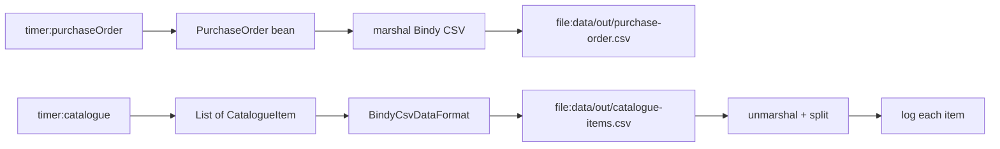

# Chapter 3: Bindy CSV

Marshal and unmarshal CSV with Camel Bindy. Merges the near-identical public demos for bindy and CSV writing into one module.

## Goal

Turn Java beans into CSV files (and back) using `@CsvRecord` / `@DataField`, without hand-rolled string concatenation.

## What You Will Learn

- Annotating models with `@CsvRecord` and `@DataField`
- `marshal().bindy(BindyType.Csv, …)` for a single record
- `BindyCsvDataFormat` for a list of catalogue items
- Writing CSV to disk and reading it back with `unmarshal`

## Prerequisites / Previous

- [Chapter 2: Camel SQL](../camel-sql/)

## Concepts



## Code Walkthrough

| Class / Path | Role |
|--------------|------|
| [`CamelBindyCsvApplication`](src/main/java/com/blazeb/camel/bindy/CamelBindyCsvApplication.java) | Spring Boot entry point |
| [`PurchaseOrder`](src/main/java/com/blazeb/camel/bindy/model/PurchaseOrder.java) | Single-row CSV model (`name`, `price`, `amount`) |
| [`CatalogueItem`](src/main/java/com/blazeb/camel/bindy/model/CatalogueItem.java) | Multi-row model with header columns |
| [`PurchaseOrderCsvRoute`](src/main/java/com/blazeb/camel/bindy/route/PurchaseOrderCsvRoute.java) | Timer → marshal → `purchase-order.csv` |
| [`CatalogueCsvRoute`](src/main/java/com/blazeb/camel/bindy/route/CatalogueCsvRoute.java) | Timer → marshal list; file consumer unmarshals |
| [`PurchaseOrderCsvRouteTest`](src/test/java/com/blazeb/camel/bindy/PurchaseOrderCsvRouteTest.java) | Asserts marshalled CSV contains SKU and price |

```java
from("timer:purchaseOrder?period={{bindy.timer.period}}&repeatCount=1")
    .routeId("purchase-order-csv")
    .process(e -> e.getIn().setBody(new PurchaseOrder("AKC4433", new BigDecimal("157.79"), 3)))
    .marshal().bindy(BindyType.Csv, PurchaseOrder.class)
    .to("file:data/out?fileName=purchase-order.csv&charset=utf-8");
```

## How To Run

```bash
cd camel-bindy-csv
mvn spring-boot:run
```

| Property | Default |
|----------|---------|
| `bindy.timer.period` | `5000` |
| Output directory | `data/out/` (created relative to CWD) |

### Expected Output

Files under `camel-bindy-csv/data/out/`:

**`purchase-order.csv`** (single record, no header):

```text
AKC4433,157.79,3
```

**`catalogue-items.csv`** (header + three rows):

```text
sku,title,category,unitPrice
SKU-100,Notebook,stationery,4.50
SKU-200,USB Hub,electronics,19.99
SKU-300,Desk Lamp,home,24.00
```

Logs include `Wrote purchase-order.csv`, `Wrote catalogue-items.csv`, and `Unmarshaled item: …` for each catalogue row.

## How To Test

```bash
cd camel-bindy-csv
mvn test
```

The test AdviceWith-replaces file/`timer` endpoints, sends a `PurchaseOrder`, and asserts the mock body contains `AKC4433` and `157.79`.

## Try It

1. Change the purchase order amount and re-run; inspect the CSV.
2. Add a fourth `CatalogueItem` in `CatalogueCsvRoute`; confirm a new row.
3. Hand-edit `catalogue-items.csv` and restart; watch unmarshal logs.
4. Set `generateHeaderColumns = false` on `CatalogueItem` and compare output.
5. Unmarshal `purchase-order.csv` in a new route and log the bean fields.

## Common Errors And Fixes

| Symptom | Fix |
|---------|-----|
| No files written | Run from `camel-bindy-csv/` so `data/out` is created next to the module |
| Number format issues | Keep `BigDecimal` with `precision = 2` on price fields |
| Unmarshal fails | Column order must match `@DataField(pos = …)` |

## Further Reading

- [Camel Bindy](https://camel.apache.org/components/4.8.x/dataformats/bindy-dataformat.html)
- [CSV data format](https://camel.apache.org/components/4.8.x/dataformats/csv-dataformat.html)

## Navigation

| | |
| --- | --- |
| Previous | [Chapter 2: Camel SQL](../camel-sql/) |
| Next | [Chapter 4: Camel Kafka](../camel-kafka/) |
| Overview | [Spring Integration Learning](../README.md) |
