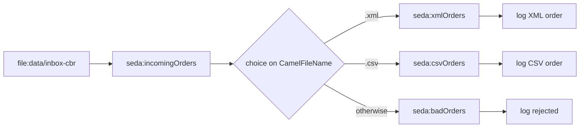

# Chapter 1: Camel In Action

Learn core Camel EIPs with the Java DSL: file copy, content-based router, filter, multicast, wire tap, and recipient list — without needing an external message broker.

## Goal

Build intuition for how a `RouteBuilder` moves exchanges through EIP steps. SEDA endpoints stand in for queues so every demo runs locally with sample files under `data/`.

## What You Will Learn

- How Spring Boot discovers `RouteBuilder` beans and starts a `CamelContext`
- Content-based routing on `CamelFileName`
- XPath filters to drop test messages
- Parallel multicast and dynamic recipient lists
- Wire tap for a non-blocking audit copy
- Selecting one demo at a time with `demo.route`

## Prerequisites / Previous

- JDK 21+, Maven 3.9+
- Read [Camel Basics](../README.md#camel-basics) in the root overview

## Concepts

Only one demo route class is active at a time (`@ConditionalOnProperty(name = "demo.route", …)`). The default is `cbr`.



| `demo.route` | Class | Behaviour |
|--------------|-------|-----------|
| `cbr` (default) | `ContentBasedRouterRoute` | Extension-based CBR into SEDA queues |
| `file-copy` | `FileCopyRoute` | `data/inbox` → `data/outbox` |
| `filter` | `FilterRoute` | XML only, then XPath filter drops `@test` orders |
| `multicast` | `MulticastRoute` | XML fan-out to accounting + production in parallel |
| `wiretap` | `WireTapRoute` | `direct:orders` → wireTap audit + fulfil |
| `recipient-list` | `RecipientListRoute` | Header-driven recipient list to warehouse + billing |

## Code Walkthrough

| Class / Path | Role |
|--------------|------|
| [`CamelInActionApplication`](src/main/java/com/blazeb/camel/inaction/CamelInActionApplication.java) | Spring Boot entry point |
| [`ContentBasedRouterRoute`](src/main/java/com/blazeb/camel/inaction/route/ContentBasedRouterRoute.java) | Default CBR demo (`routeId`s `cbr-*`) |
| [`FileCopyRoute`](src/main/java/com/blazeb/camel/inaction/route/FileCopyRoute.java) | Simple file copy |
| [`FilterRoute`](src/main/java/com/blazeb/camel/inaction/route/FilterRoute.java) | CBR + XPath filter |
| [`MulticastRoute`](src/main/java/com/blazeb/camel/inaction/route/MulticastRoute.java) | Parallel multicast |
| [`WireTapRoute`](src/main/java/com/blazeb/camel/inaction/route/WireTapRoute.java) | Wire tap on `direct:orders` |
| [`RecipientListRoute`](src/main/java/com/blazeb/camel/inaction/route/RecipientListRoute.java) | Recipient list on `direct:dispatch` |
| [`ContentBasedRouterRouteTest`](src/test/java/com/blazeb/camel/inaction/ContentBasedRouterRouteTest.java) | AdviceWith smoke test for CBR |
| `data/inbox*` | Sample inputs (also mirrored under `src/main/resources/data`) |

Main CBR route (abbreviated):

```java
from("file:data/inbox-cbr?noop=true")
    .routeId("cbr-ingest")
    .to("seda:incomingOrders");

from("seda:incomingOrders")
    .routeId("cbr-router")
    .choice()
        .when(header("CamelFileName").endsWith(".xml")).to("seda:xmlOrders")
        .when(header("CamelFileName").endsWith(".csv")).to("seda:csvOrders")
        .otherwise().to("seda:badOrders");
```

## How To Run

Run from this module directory so relative `data/…` paths resolve:

```bash
cd camel-in-action
mvn spring-boot:run
```

| Setting | Value |
|---------|-------|
| Active demo | `demo.route=cbr` (default in `application.properties`) |
| Sample inputs | `data/inbox-cbr/message1.xml`, `message2.csv`, `message3.bad` |

Switch demos:

```bash
mvn spring-boot:run -Dspring-boot.run.arguments=--demo.route=file-copy
mvn spring-boot:run -Dspring-boot.run.arguments=--demo.route=filter
mvn spring-boot:run -Dspring-boot.run.arguments=--demo.route=multicast
```

`wiretap` and `recipient-list` listen on `direct:` endpoints (no file poller). Prefer reading the route classes and the CBR unit test pattern; trigger them from a test with `ProducerTemplate` if you want live logs.

### Expected Output (CBR)

After start you should see log lines similar to:

```text
XML order: message1.xml
CSV order: message2.csv
Rejected order: message3.bad
```

### Expected Output (file-copy)

`data/outbox/message1.xml` appears (copy of `data/inbox/message1.xml`).

### Expected Output (filter)

`message1.xml` is accepted; `testmessage.xml` (has `@test`) is filtered out — no “Accepted XML order” line for it.

### Expected Output (multicast)

Both:

```text
Accounting received: message1.xml
Production received: message1.xml
```

## How To Test

```bash
cd camel-in-action
mvn test
```

`ContentBasedRouterRouteTest` replaces the file consumer with `direct:cbr-ingest`, sends `.xml` / `.csv` / `.bad` payloads, and asserts one message each on mock XML, CSV, and bad endpoints.

## Try It

1. Drop a new `.xml` into `data/inbox-cbr` while the CBR demo is running; confirm a new XML log line.
2. Rename a file to `.csv` and confirm it hits the CSV lane.
3. Switch to `filter` and add an order XML **without** `@test`; confirm it is accepted.
4. Switch to `multicast` and add a second XML; confirm both accounting and production log twice.
5. Write a small test (copy the AdviceWith pattern) that sends a body to `direct:orders` with `demo.route=wiretap`.

## Common Errors And Fixes

| Symptom | Fix |
|---------|-----|
| No file activity | Run from `camel-in-action/` so `data/inbox*` exists relative to CWD |
| Wrong demo active | Pass `--demo.route=…` or edit `application.properties` |
| `wiretap` / `recipient-list` silent | Those routes have no file/`timer` consumer — use tests or `ProducerTemplate` |
| Test fails on AdviceWith | Ensure `@UseAdviceWith` and call `camelContext.start()` after advice |

## Further Reading

- [Camel Java DSL](https://camel.apache.org/manual/java-dsl.html)
- [Content Based Router EIP](https://camel.apache.org/components/4.8.x/eips/content-based-router-eip.html)
- [Multicast EIP](https://camel.apache.org/components/4.8.x/eips/multicast-eip.html)
- [Wire Tap EIP](https://camel.apache.org/components/4.8.x/eips/wireTap-eip.html)

## Navigation

| | |
| --- | --- |
| Previous | [Spring Integration Learning](../README.md) (overview + Camel Basics) |
| Next | [Chapter 2: Camel SQL](../camel-sql/) |
| Overview | [Spring Integration Learning](../README.md) |
