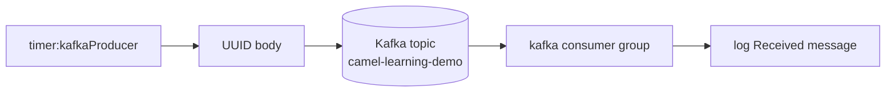

# Chapter 4: Camel Kafka

Produce and consume Kafka messages with the Camel Kafka component (Java DSL).

## Goal

Publish a UUID every few seconds to a topic and consume it in the same JVM, using env-overridable brokers / topic / group id.

## What You Will Learn

- Timer-driven Kafka producers via `kafka:topic?brokers=…`
- Consumer groups and `autoOffsetReset=earliest`
- Externalising brokers with `KAFKA_BROKERS`
- Testing Kafka routes with AdviceWith (no broker required for unit tests)

## Prerequisites / Previous

- [Chapter 3: Bindy CSV](../camel-bindy-csv/)
- A Kafka broker for live runs — easiest: Chapter 6 compose (`docker compose up -d kafka` in `course-enrolment-pipeline/`)

## Concepts



## Code Walkthrough

| Class / Path | Role |
|--------------|------|
| [`CamelKafkaApplication`](src/main/java/com/blazeb/camel/kafka/CamelKafkaApplication.java) | Spring Boot entry point |
| [`KafkaDemoRoute`](src/main/java/com/blazeb/camel/kafka/route/KafkaDemoRoute.java) | Producer + consumer routes |
| [`KafkaDemoRouteTest`](src/test/java/com/blazeb/camel/kafka/KafkaDemoRouteTest.java) | Mocks `kafka:*` endpoints |

```java
from("timer:kafkaProducer?period={{kafka.producer.period}}")
    .routeId("kafka-producer")
    .process(e -> e.getIn().setBody(UUID.randomUUID().toString()))
    .to("kafka:{{kafka.topic}}?brokers={{kafka.brokers}}");

from("kafka:{{kafka.topic}}?brokers={{kafka.brokers}}&groupId={{kafka.group-id}}"
        + "&autoOffsetReset=earliest")
    .routeId("kafka-consumer")
    .log("Received message ${body}");
```

## How To Run

Start Kafka first (from Chapter 6):

```bash
cd course-enrolment-pipeline
docker compose up -d kafka
```

Then:

```bash
cd camel-kafka
export KAFKA_BROKERS=localhost:9092
mvn spring-boot:run
```

| Property / Env | Default |
|----------------|---------|
| `kafka.brokers` / `KAFKA_BROKERS` | `localhost:9092` |
| `kafka.topic` / `KAFKA_TOPIC` | `camel-learning-demo` |
| `kafka.group-id` / `KAFKA_GROUP_ID` | `camel-learning-group` |
| `kafka.producer.period` | `10000` |
| `kafka.demo.enabled` | `true` |

Host port `9092` maps to the compose KRaft `PLAINTEXT_HOST` listener (advertised as `localhost:9092`).

### Expected Output

Every ~10 seconds:

```text
Sending message <uuid>
Received message <uuid>
```

Optional: start Kafdrop (`docker compose --profile ui up -d kafdrop` in Chapter 6) and open http://localhost:9000 to inspect topic `camel-learning-demo`.

## How To Test

```bash
cd camel-kafka
mvn test
```

Unit tests replace `kafka:` URIs with mocks so CI does not need a broker. Live broker behaviour is covered in Chapter 6’s Testcontainers IT.

## Try It

1. Change `KAFKA_TOPIC` and restart; confirm a new topic appears in Kafdrop.
2. Start a second consumer with a different `KAFKA_GROUP_ID`; both groups should see messages (`autoOffsetReset=earliest` helps on first connect).
3. Set `kafka.demo.enabled=false` and confirm routes do not start.
4. Lower `kafka.producer.period` to `2000` and watch throughput.
5. Publish a fixed string instead of a UUID and filter it in the consumer with `.filter()`.

## Common Errors And Fixes

| Symptom | Fix |
|---------|-----|
| `Connection to node … could not be established` | `docker compose up -d kafka` in `course-enrolment-pipeline`; check `KAFKA_BROKERS=localhost:9092` |
| Producer works, consumer silent | Confirm same topic name; check consumer group / offset |
| Port confusion with compose | Host clients use `localhost:9092` (mapped to the host listener) |

## Further Reading

- [Camel Kafka component](https://camel.apache.org/components/4.8.x/kafka-component.html)
- [Kafka consumers](https://kafka.apache.org/documentation/#consumerapi)

## Navigation

| | |
| --- | --- |
| Previous | [Chapter 3: Bindy CSV](../camel-bindy-csv/) |
| Next | [Chapter 5: ActiveMQ JMS](../activemq-jms/) |
| Overview | [Spring Integration Learning](../README.md) |
