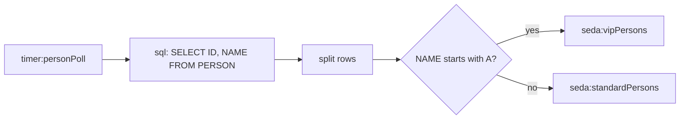

# Chapter 2: Camel SQL

Use the Camel SQL component against an embedded H2 database: poll rows on a timer, split results, and content-based route by name prefix.

## Goal

Connect Spring’s `DataSource` to `sql:` endpoints and practice row-level EIPs without installing Oracle or Postgres.

## What You Will Learn

- Wiring `sql:…?dataSource=#dataSource`
- Timer-driven database polling (`person.poll.period`)
- Splitting a result list and routing with `choice()`
- Seeding schema with `schema.sql` / `data.sql`

## Prerequisites / Previous

- JDK 21+, Maven 3.9+
- [Chapter 1: Camel In Action](../camel-in-action/)

## Concepts



Seeded names: `Ada`, `Ben`, `Asha`, `Kai`, `Alex`. Names starting with **A** take the VIP lane.

## Code Walkthrough

| Class / Path | Role |
|--------------|------|
| [`CamelSqlApplication`](src/main/java/com/blazeb/camel/sql/CamelSqlApplication.java) | Spring Boot entry point |
| [`PersonSqlRoute`](src/main/java/com/blazeb/camel/sql/route/PersonSqlRoute.java) | Timer → SQL → split → CBR |
| [`Person`](src/main/java/com/blazeb/camel/sql/model/Person.java) | JPA entity mapped to `PERSON` |
| [`PersonRepository`](src/main/java/com/blazeb/camel/sql/repository/PersonRepository.java) | Spring Data repository (available for extensions) |
| [`schema.sql`](src/main/resources/schema.sql) / [`data.sql`](src/main/resources/data.sql) | H2 DDL + seed rows |
| [`PersonSqlRouteTest`](src/test/java/com/blazeb/camel/sql/PersonSqlRouteTest.java) | AdviceWith test with mocked SQL results |

Abbreviated route:

```java
from("timer:personPoll?period={{person.poll.period}}")
    .routeId("person-sql-poll")
    .to("sql:SELECT ID, NAME FROM PERSON ORDER BY ID?dataSource=#dataSource")
    .split(body())
    .process(/* set personId / personName headers */)
    .choice()
        .when(header("personName").startsWith("A")).to("seda:vipPersons")
        .otherwise().to("seda:standardPersons");
```

## How To Run

```bash
cd camel-sql
mvn spring-boot:run
```

| Property | Default |
|----------|---------|
| `person.poll.period` | `10000` (ms) |
| JDBC URL | `jdbc:h2:mem:camelsql;…MODE=PostgreSQL` |
| User / password | `sa` / *(empty)* |

No HTTP port is required for the demo (JDBC + Camel only).

### Expected Output

Every ~10 seconds:

```text
VIP lane: id=1 name=Ada
Standard lane: id=2 name=Ben
VIP lane: id=3 name=Asha
Standard lane: id=4 name=Kai
VIP lane: id=5 name=Alex
VIP processed: Ada
…
```

## How To Test

```bash
cd camel-sql
mvn test
```

The test replaces the timer with `direct:person-poll`, stubs the SQL step with two in-memory rows (`Ada`, `Ben`), and asserts one VIP and one standard mock message.

## Try It

1. Change `person.poll.period` to `3000` and confirm faster polls.
2. Insert another row (temporarily add an `INSERT` in `data.sql`) whose name starts with `B`; confirm the standard lane.
3. Change the VIP predicate from `startsWith("A")` to another letter and restart.
4. Log `ID` and `NAME` as JSON using Camel’s Jackson starter (dependency already on the POM).
5. Call `PersonRepository.findAll()` from a processor instead of the SQL component and compare.

## Common Errors And Fixes

| Symptom | Fix |
|---------|-----|
| Empty polls | Confirm `schema.sql` / `data.sql` loaded (`spring.sql.init.mode=always`) |
| H2 / Flyway confusion | This module uses Spring SQL init, **not** Flyway (Flyway is Chapter 6) |
| Test cannot find `sql:*` weave | Match the AdviceWith pattern in `PersonSqlRouteTest` |

## Further Reading

- [Camel SQL component](https://camel.apache.org/components/4.8.x/sql-component.html)
- [Spring Boot SQL init](https://docs.spring.io/spring-boot/reference/data/sql.html)

## Navigation

| | |
| --- | --- |
| Previous | [Chapter 1: Camel In Action](../camel-in-action/) |
| Next | [Chapter 3: Bindy CSV](../camel-bindy-csv/) |
| Overview | [Spring Integration Learning](../README.md) |
