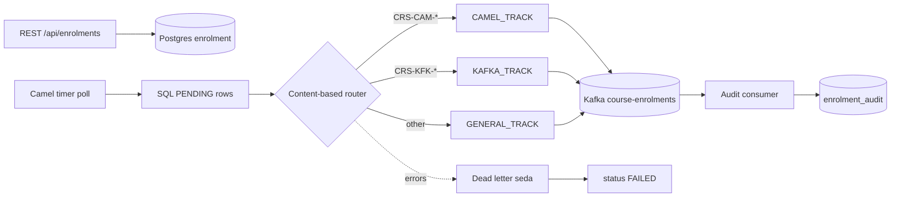

# Chapter 6: Course enrolment pipeline

Capstone: a fictional course-enrolment domain (student id, course code, enrolled date — no real PII) that ties REST ingest, Postgres, Camel SQL polling, content-based routing, validation, dead-letter handling, idempotency, Kafka, and an audit consumer.

## Architecture



## What you learn

- REST ingest with Bean Validation and idempotency keys
- Flyway schema + seed data
- Camel SQL polling, CBR, DLQ, and Kafka publish
- Audit/report consumer writing derived rows
- Testcontainers integration test for Postgres + Kafka

## How to run

### 1. Start infrastructure

```bash
cd course-enrolment-pipeline
docker compose up -d postgres kafka
# optional UI
docker compose --profile ui up -d kafdrop
```

Host Kafka bootstrap: `localhost:9092` (mapped from the KRaft broker).

### 2. Run the app

```bash
export ENROLMENT_DB_URL=jdbc:postgresql://localhost:5432/enrolment
export ENROLMENT_DB_USER=enrolment
export ENROLMENT_DB_PASSWORD=enrolment
export KAFKA_BROKERS=localhost:9092
mvn spring-boot:run
```

### 3. Ingest an enrolment

```bash
curl -s -X POST http://localhost:8086/api/enrolments \
  -H 'Content-Type: application/json' \
  -d '{"studentId":"STU-2001","courseCode":"CRS-CAM-101","enrolledDate":"2026-02-01"}'
```

Seeded PENDING rows are also processed automatically on the poll timer.

### 4. Inspect

- Postgres: `enrolment` and `enrolment_audit`
- Kafdrop (optional): http://localhost:9000

## Try it

1. POST the same payload twice — idempotency should reuse the same row.
2. Use `CRS-KFK-201` vs `CRS-CAM-101` and confirm lane values in audit rows.
3. Break validation (`studentId` format) and confirm HTTP 400; force a route failure and watch DLQ → `FAILED`.

## Tests

```bash
mvn verify
```

`CourseEnrolmentPipelineIT` uses Testcontainers and is skipped when Docker is unavailable (`disabledWithoutDocker = true`).

Previous: [Chapter 5: ActiveMQ JMS](../activemq-jms/) · Next: [Chapter 0 overview](../README.md)
