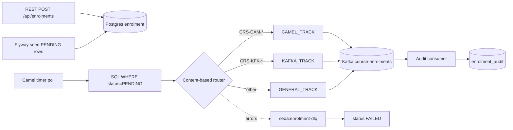
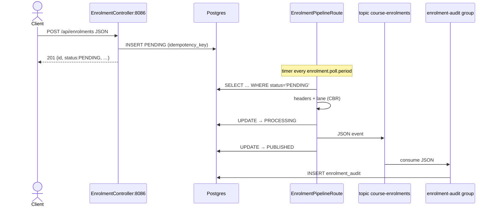

# Chapter 6: Course Enrolment Pipeline

Capstone module: a fictional course-enrolment domain (student id, course code, enrolled date — **no** SSN/DOB/real-looking PII) that ties REST ingest, Postgres, Camel SQL polling, content-based routing, validation, dead-letter handling, idempotency, Kafka, and an audit consumer.

## Goal

Ship one end-to-end integration you can run with Docker Compose, exercise with `curl`, inspect in Postgres/Kafdrop, and verify with Testcontainers.

## What You Will Learn

- REST ingest with Bean Validation and idempotent inserts
- Flyway schema + seed data on Postgres
- Camel SQL polling, CBR lanes, DLQ, and Kafka publish
- A Kafka consumer that writes an audit/report row
- docker compose for Postgres + Kafka KRaft (+ optional Kafdrop)
- Testcontainers integration tests for the full path

## Prerequisites / Previous

- [Chapter 5: ActiveMQ JMS](../activemq-jms/) (contrast) and Chapters 1–4 (Camel building blocks)
- JDK 21+, Maven 3.9+, Docker Compose v2

## Architecture



### Sequence: One Enrolment End-To-End



## Data Model

Flyway scripts: [`V1__enrolment_schema.sql`](src/main/resources/db/migration/V1__enrolment_schema.sql), [`V2__enrolment_seed.sql`](src/main/resources/db/migration/V2__enrolment_seed.sql).

### `enrolment`

| Column | Type | Notes |
|--------|------|-------|
| `id` | BIGINT identity | Primary key |
| `student_id` | VARCHAR(32) | e.g. `STU-1001` |
| `course_code` | VARCHAR(32) | e.g. `CRS-CAM-101` |
| `enrolled_date` | DATE | Enrolment day |
| `status` | VARCHAR(32) | `PENDING` → `PROCESSING` → `PUBLISHED` / `FAILED` |
| `idempotency_key` | VARCHAR(128) | Unique: `studentId\|courseCode\|enrolledDate` |
| `created_at` | TIMESTAMP | Default now |

### `enrolment_audit`

| Column | Type | Notes |
|--------|------|-------|
| `id` | BIGINT identity | Primary key |
| `enrolment_id` | BIGINT | Source enrolment id |
| `student_id` / `course_code` / `enrolled_date` | copied | From Kafka event |
| `lane` | VARCHAR(32) | `CAMEL_TRACK` / `KAFKA_TRACK` / `GENERAL_TRACK` |
| `report_line` | VARCHAR(256) | e.g. `STU-1001 enrolled in CRS-CAM-101` |
| `created_at` | TIMESTAMP | Default now |

### REST Validation (`EnrolmentRequest`)

| Field | Rule |
|-------|------|
| `studentId` | `STU-[0-9]{4}` |
| `courseCode` | `CRS-[A-Z]{3}-[0-9]{3}` |
| `enrolledDate` | ISO date, required |

### Content-Based Lanes

| Course code prefix | Header `enrolmentLane` |
|--------------------|------------------------|
| `CRS-CAM-` | `CAMEL_TRACK` |
| `CRS-KFK-` | `KAFKA_TRACK` |
| anything else | `GENERAL_TRACK` |

## Kafka Topic And Message Schema

| Setting | Default | Env |
|---------|---------|-----|
| Topic | `course-enrolments` | `ENROLMENT_KAFKA_TOPIC` |
| Brokers | `localhost:9092` | `KAFKA_BROKERS` |
| Audit group | `enrolment-audit` | `ENROLMENT_KAFKA_AUDIT_GROUP` |

Example JSON published after a successful mark-processing step (field names from `buildEventBody`):

```json
{
  "id": 5,
  "studentId": "STU-2001",
  "courseCode": "CRS-CAM-101",
  "enrolledDate": "2026-02-01",
  "enrolmentLane": "CAMEL_TRACK",
  "idempotencyKey": "STU-2001|CRS-CAM-101|2026-02-01"
}
```

## Idempotency And Dead Letter

**Idempotency.** `EnrolmentIngestService` builds `idempotency_key = studentId|courseCode|enrolledDate`. A unique index enforces it. A duplicate POST catches `DuplicateKeyException` and returns the existing row id (still HTTP 201 with the same logical enrolment).

**Optimistic claim.** The route updates `PENDING` → `PROCESSING` and only publishes when the update count is `> 0`, so two pollers cannot double-publish the same row.

**Dead letter.** Route-level `deadLetterChannel("seda:enrolment-dlq")` with redeliveries. Exhausted failures log and, when `id` is present, set `status = FAILED`.

## Code Walkthrough

| Class / Path | Role |
|--------------|------|
| [`CourseEnrolmentApplication`](src/main/java/com/blazeb/camel/enrolment/CourseEnrolmentApplication.java) | Spring Boot entry point |
| [`EnrolmentController`](src/main/java/com/blazeb/camel/enrolment/web/EnrolmentController.java) | `POST /api/enrolments` |
| [`EnrolmentRequest`](src/main/java/com/blazeb/camel/enrolment/model/EnrolmentRequest.java) | Validated request body |
| [`EnrolmentIngestService`](src/main/java/com/blazeb/camel/enrolment/service/EnrolmentIngestService.java) | Idempotent insert |
| [`EnrolmentPipelineRoute`](src/main/java/com/blazeb/camel/enrolment/route/EnrolmentPipelineRoute.java) | Poll, CBR, publish, audit, DLQ |
| [`V1__` / `V2__` migrations](src/main/resources/db/migration/) | Schema + seed PENDING rows |
| [`docker-compose.yml`](docker-compose.yml) | Postgres 16, Kafka 3.8 KRaft, optional Kafdrop |
| [`EnrolmentControllerTest`](src/test/java/com/blazeb/camel/enrolment/EnrolmentControllerTest.java) | MockMvc API smoke |
| [`EnrolmentPipelineRouteTest`](src/test/java/com/blazeb/camel/enrolment/EnrolmentPipelineRouteTest.java) | AdviceWith CBR → Kafka mock |
| [`CourseEnrolmentPipelineIT`](src/test/java/com/blazeb/camel/enrolment/CourseEnrolmentPipelineIT.java) | Testcontainers Postgres + Kafka |

Poll + publish (abbreviated):

```java
from("timer:enrolmentPoll?period={{enrolment.poll.period}}")
    .routeId("enrolment-poll")
    .to("sql:SELECT id, student_id, course_code, … FROM enrolment WHERE status = 'PENDING' …")
    .split(body())
    .to("direct:process-enrolment");

// … CBR sets enrolmentLane, then:
.from("direct:mark-processing")
    .to("sql:UPDATE enrolment SET status = 'PROCESSING' WHERE id = :#id AND status = 'PENDING'")
    .filter(simple("${body} > 0"))
    .setBody(exchangeProperty("enrolmentEvent"))
    .marshal().json(JsonLibrary.Jackson)
    .to("kafka:{{enrolment.kafka.topic}}?brokers={{enrolment.kafka.brokers}}")
    .to("sql:UPDATE enrolment SET status = 'PUBLISHED' WHERE id = :#id");
```

## How To Run (Docker Compose Step-By-Step)

### 1. Start Infrastructure

```bash
cd course-enrolment-pipeline
docker compose up -d postgres kafka
```

| Service | Host port | Notes |
|---------|----------:|-------|
| Postgres | 5432 | DB/user/password `enrolment` |
| Kafka | 9092 | Host → container `PLAINTEXT_HOST` (advertised `localhost:9092`) |

Optional UI:

```bash
docker compose --profile ui up -d kafdrop
# http://localhost:9000  (broker connect kafka:9092 inside the network)
```

### 2. Export App Config

```bash
export ENROLMENT_DB_URL=jdbc:postgresql://localhost:5432/enrolment
export ENROLMENT_DB_USER=enrolment
export ENROLMENT_DB_PASSWORD=enrolment
export KAFKA_BROKERS=localhost:9092
# optional:
# export ENROLMENT_POLL_PERIOD=5000
# export ENROLMENT_KAFKA_TOPIC=course-enrolments
```

| Property | Default |
|----------|---------|
| `server.port` | `8086` |
| `enrolment.poll.period` | `5000` |
| `enrolment.kafka.topic` | `course-enrolments` |
| `enrolment.kafka.audit-group` | `enrolment-audit` |

### 3. Start The App

```bash
mvn spring-boot:run
```

Flyway applies V1/V2 on startup. Seeded PENDING rows (`STU-1001`…`STU-1004`) begin flowing on the first poll.

### 4. Ingest With curl

```bash
curl -s -X POST http://localhost:8086/api/enrolments \
  -H 'Content-Type: application/json' \
  -d '{"studentId":"STU-2001","courseCode":"CRS-CAM-101","enrolledDate":"2026-02-01"}'
```

**Expected HTTP body:**

```json
{
  "id": 5,
  "status": "PENDING",
  "studentId": "STU-2001",
  "courseCode": "CRS-CAM-101"
}
```

Repeat the same payload — you should get the **same** `id` back (idempotent insert).

Validation failure example:

```bash
curl -s -o /tmp/out -w "%{http_code}" -X POST http://localhost:8086/api/enrolments \
  -H 'Content-Type: application/json' \
  -d '{"studentId":"bad","courseCode":"CRS-CAM-101","enrolledDate":"2026-02-01"}'
# expect 400
```

### 5. See Messages And Rows

**App logs** (within a few poll periods):

```text
Published enrolment id=5 lane=CAMEL_TRACK
Audit written for enrolment 5
```

**Postgres:**

```bash
docker compose exec postgres psql -U enrolment -d enrolment -c \
  "SELECT id, student_id, course_code, status FROM enrolment ORDER BY id;"
docker compose exec postgres psql -U enrolment -d enrolment -c \
  "SELECT enrolment_id, lane, report_line FROM enrolment_audit ORDER BY id;"
```

Expect `PUBLISHED` statuses and audit rows with lanes `CAMEL_TRACK` / `KAFKA_TRACK` / `GENERAL_TRACK` for the seeded courses (`CRS-CAM-*`, `CRS-KFK-*`, `CRS-SQL-*`).

**Kafdrop:** open http://localhost:9000 → topic `course-enrolments` → view messages matching the JSON schema above.

### 6. Stop

```bash
# Ctrl+C the app
docker compose --profile ui down
```

## How To Test

```bash
cd course-enrolment-pipeline
mvn verify
```

| Test | Proves |
|------|--------|
| `EnrolmentControllerTest` | Valid POST returns 201 and delegates to ingest service |
| `EnrolmentPipelineRouteTest` | CBR path publishes JSON containing `CRS-CAM-101` (Kafka mocked) |
| `CourseEnrolmentPipelineIT` | Real Postgres + Kafka via Testcontainers; row becomes `PUBLISHED` and an audit row appears |

`CourseEnrolmentPipelineIT` uses `@Testcontainers(disabledWithoutDocker = true)` — skipped locally if Docker is unavailable; CI provides Docker.

## Try It

1. POST `CRS-KFK-201` and confirm audit `lane = KAFKA_TRACK`.
2. POST the same body twice; confirm a single DB row and stable id.
3. POST an invalid `studentId`; confirm HTTP 400 and no new row.
4. Lower `ENROLMENT_POLL_PERIOD` to `2000` and watch seed rows clear faster.
5. Force a failure (e.g. temporarily break the audit SQL in a local branch) and observe DLQ logs + `FAILED` status — then revert.

## Common Errors And Fixes

| Symptom | Fix |
|---------|-----|
| Flyway cannot connect | `docker compose up -d postgres`; check env URL/user/password |
| Kafka connection errors | `docker compose up -d kafka`; `KAFKA_BROKERS=localhost:9092` |
| Enrolments stuck in `PENDING` | App running? Check Camel logs for SQL/Kafka errors |
| Duplicate key on seed re-run | Normal if data remains; `docker compose down -v` to reset volumes |
| IT skipped | Install/start Docker; CI still runs the IT |
| Kafdrop empty | Topic name `course-enrolments`; wait for a publish; refresh UI |

## Further Reading

- [Camel SQL component](https://camel.apache.org/components/4.8.x/sql-component.html)
- [Camel Kafka component](https://camel.apache.org/components/4.8.x/kafka-component.html)
- [Dead Letter Channel EIP](https://camel.apache.org/components/4.8.x/eips/dead-letter-channel.html)
- [Flyway](https://documentation.red-gate.com/fd/flyway-documentation-138346877.html)
- [Testcontainers](https://java.testcontainers.org/)

## Navigation

| | |
| --- | --- |
| Previous | [Chapter 5: ActiveMQ JMS](../activemq-jms/) |
| Next | [Spring Integration Learning](../README.md) (overview) |
| Overview | [Spring Integration Learning](../README.md) |
